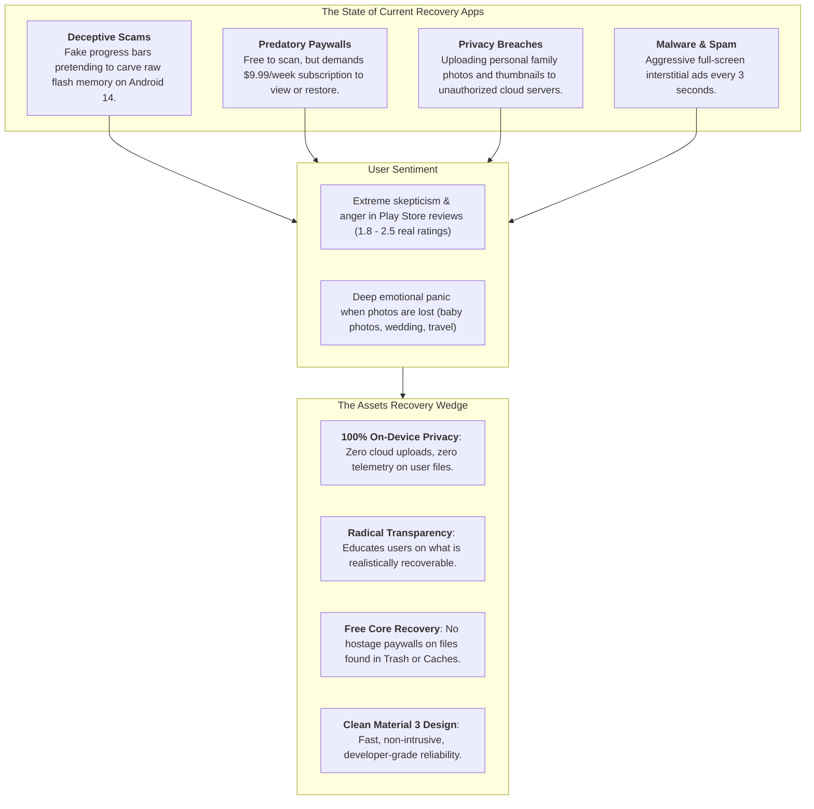
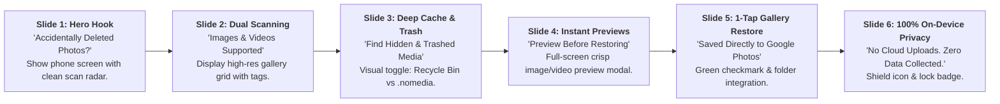
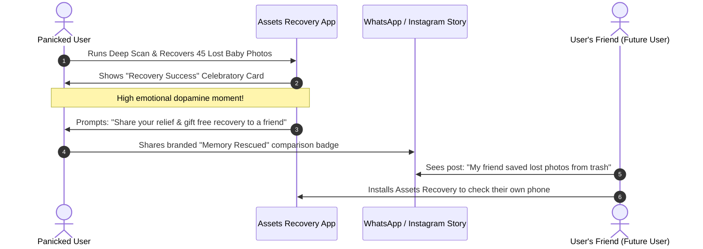
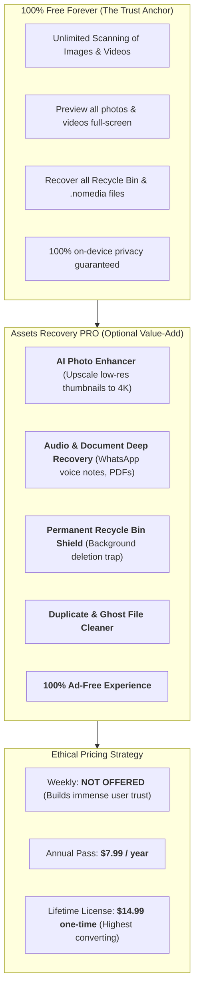
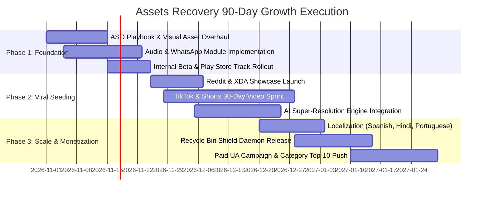

# Assets Recovery — Comprehensive Marketing Strategy & Viral Feature Roadmap

> **Document Version**: 1.0  
> **App**: Assets Recovery (`com.logybyte.assetsrecovery`)  
> **Target Audience**: Global (US, India, Brazil, Indonesia, Germany, UK, LATAM, SE Asia)  
> **Target Platforms**: Google Play Store (Android 8.0+ / API 26–35)  
> **Core Value Proposition**: The 100% Private, Honest, and Deep Media & Cache Rescue Engine for Android.  
> **Target Objective**: 1,000,000+ organic high-intent downloads, top-5 ranking in Utility & Tools, and a 4.7+ star reputation built on transparency and zero deceptive paywalls.

---

## Table of Contents
1. [App Audit & The Current State of Assets Recovery](#1-app-audit--the-current-state-of-assets-recovery)
2. [Market Opportunity & The Android Trust Crisis](#2-market-opportunity--the-android-trust-crisis)
3. [Target Personas & Emotional Triggers](#3-target-personas--emotional-triggers)
4. [Competitive Positioning & Differentiation Matrix](#4-competitive-positioning--differentiation-matrix)
5. [App Store Optimization (ASO) Master Playbook](#5-app-store-optimization-aso-master-playbook)
6. [Top Features to Introduce to Make the App Wildly Popular](#6-top-features-to-introduce-to-make-the-app-wildly-popular)
7. [Product-Led Growth (PLG) & Viral Expansion Loops](#7-product-led-growth-plg--viral-expansion-loops)
8. [Organic Content & Social Media Viral Playbook](#8-organic-content--social-media-viral-playbook)
9. [Community Seeding & Grassroots Growth (Reddit, XDA, Forums)](#9-community-seeding--grassroots-growth-reddit-xda-forums)
10. [Monetization, Retention & Ethical Pricing Model](#10-monetization-retention--ethical-pricing-model)
11. [90-Day Launch & Scale Sprint Roadmap](#11-90-day-launch--scale-sprint-roadmap)

---

## 1. App Audit & The Current State of Assets Recovery

### Current Architecture & Capabilities
Assets Recovery (`com.logybyte.assetsrecovery`) is built with modern, idiomatic Android engineering standards:
- **Language & Tech Stack**: Kotlin 1.9+, Coroutines & Kotlin Flow, ViewBinding, AndroidX Lifecycle, Coil 2.7 with Coil-Video decoding.
- **Target OS Compatibility**: Android 8.0 (API 26) through Android 15 (API 35), fully adapting to Scoped Storage requirements and Android 13+ granular media permissions (`READ_MEDIA_IMAGES`, `READ_MEDIA_VIDEO`).
- **Core Engine**:
  - `MediaScanner.kt`: Scans both active and trashed files (`MediaStore.MediaColumns.IS_TRASHED`), and performs a recursive scan of accessible external storage for hidden `.nomedia` folders, WhatsApp media paths, and cached files.
  - `RecoveryEngine.kt`: Safely copies recovered media into public `Pictures/RecoveredMedia` or `DCIM/RecoveredMedia` directories and executes `MediaScannerConnection` indexing so items immediately appear in Google Photos and device galleries.
  - `DashboardFragment.kt` & `GalleryFragment.kt`: Clean Material 3 UI displaying real-time scan progress, stats cards, filtering (All, Recoverable, Recycle Bin, Hidden/Orphaned), sorting, and batch recovery.
- **Unique Selling Factor in Code**: The app already contains an honest disclosure dialog explaining Android 10+ File-Based Encryption (FBE) and TRIM garbage collection, transparently setting expectations about what can realistically be recovered without root.

---

## 2. Market Opportunity & The Android Trust Crisis

### The Category Landscape
Every month, over **25 million global searches** take place across Google Play and search engines for terms like:
- *"how to recover deleted photos"*
- *"restore permanently deleted videos"*
- *"whatsapp deleted photo recovery app"*
- *"recently deleted recycle bin android"*



### The Market Vacuum
Most top-ranking apps in this niche (DiskDigger, Dumpster, Dr.Fone, All Recovery) are legacy applications or ad-heavy cash grabs with poor UI. Users desperately crave a **modern, trustworthy, beautiful utility** that treats them like intelligent adults, doesn't spam them, and genuinely uncovers forgotten cache pictures, WhatsApp media, and MediaStore trash items.

---

## 3. Target Personas & Emotional Triggers

Understanding who downloads recovery apps and why allows us to craft high-converting ad hooks, store listings, and feature roadmaps.

| Persona | Demographics | Pain Point / Scenario | Emotional Trigger | Conversion Hook |
| :--- | :--- | :--- | :--- | :--- |
| **The Panic Deleter** | Age 18–45, Male & Female | Accidentally hit "Empty Trash" or deleted vacation/wedding/baby pictures 10 minutes ago. | High anxiety, panic, guilt, urgency. | *"Don't panic! Check if your photos are still in Android's hidden trash or cache buffer."* |
| **The Social Media Hunter** | Age 16–30, WhatsApp/Telegram power users | Friend deleted a WhatsApp photo or status ("This message was deleted"); user wants it back. | Curiosity, FOMO, social intrigue. | *"Find deleted WhatsApp photos and statuses buried in your phone's hidden media cache."* |
| **The Nostalgia Explorer** | Age 22–40, Android users upgrading or exploring old phones | Looking through an old phone, hoping to rediscover lost childhood or college memories. | Nostalgia, curiosity, sentimentality. | *"Dig up forgotten photos and videos hiding in forgotten app folders and .nomedia caches."* |
| **The Storage Doctor** | Age 25–55, Budget Android users (64GB–128GB phones) | Storage full; wants to see what ghost files, orphaned caches, or broken media files are hogging space. | Frustration with storage warnings. | *"Find and safely salvage broken, orphaned, or forgotten media taking up gigabytes."* |

---

## 4. Competitive Positioning & Differentiation Matrix

| Attribute / Feature | **Assets Recovery** | **DiskDigger** | **Dr.Fone / UltData** | **Dumpster** | **Generic Scam Apps** |
| :--- | :---: | :---: | :---: | :---: | :---: |
| **Core Recovery Engine** | Native MediaStore + Deep `.nomedia` Cache Crawler | Root sector carving / Basic cache thumbnails | PC companion tether / Cloud service | Pre-installed bin (only works *after* install) | Fake UI timer; displays existing gallery photos |
| **User Privacy** | **100% Local (Zero uploads)** | Local | Cloud uploads / Account required | Account required | Sends analytics & media metadata |
| **Honesty & Transparency** | **Clear FBE/TRIM technical disclosure** | Technical | Overpromises impossible recoveries | Moderate | Blatant lies ("Recover after factory reset") |
| **UI/UX Standard** | **Modern Material 3, Dark Mode, Coil Video** | Android 4.4 Holo / Material 1 legacy UI | Corporate web-wrapper | Cluttered with banners | Obnoxious popups & countdowns |
| **Video Decoding & Preview** | **Smooth native preview with Coil-Video** | Buggy preview for MP4 | Requires PC export | Good | Broken previews |
| **Pricing Model** | **Free Core Recovery + Ethical Pro Upgrade** | Ad-supported / Pro | $49.99/yr or $9.99/mo | $9.99/mo subscription | Paywall locks downloaded files |

---

## 5. App Store Optimization (ASO) Master Playbook

ASO accounts for **70%+ of total downloads** in utility apps. The goal is to capture both high-volume generic keywords and high-conversion intent keywords.

### Google Play Store Metadata Specification

#### App Title (30 / 30 Characters Max)
`Assets Recovery: Photo & Video`  
*(Alternative variant: `Photo Recovery - Restore Media`)*

#### Short Description (80 / 80 Characters Max)
`Safely recover deleted photos, videos & hidden media from trash and app caches.`

#### Long Description (Structured for Keyword Density & Trust Conversion)
```markdown
Accidentally deleted important photos or videos? Looking for pictures buried in hidden folders, WhatsApp media caches, or the Android Recycle Bin?

Assets Recovery is the safe, private, and transparent media rescue tool designed to find and restore accessible images and videos on your Android device.

🔍 WHAT ASSETS RECOVERY DOES:
• MediaStore Trash Rescue: Recovers photos and videos stored in Android’s system recycle bin (available on supported Android 11+ devices).
• Hidden & Orphaned Media Scan: Deeply searches .nomedia directories, app cache folders, and unindexed subdirectories for overlooked images and videos.
• Broken & Inaccessible Media Restoration: Safely extracts files with damaged extensions or missing gallery indexing and restores them to your public gallery.
• High-Definition Previews: Preview photos and stream videos directly within the app before restoring.
• Batch One-Tap Recovery: Restore individual files or select hundreds at once. Restored files are immediately organized into Pictures/RecoveredMedia and visible in Google Photos and Gallery apps.

🛡️ 100% PRIVATE & ON-DEVICE
Your memories belong to you. Assets Recovery performs every single scan and restoration operation 100% locally on your device. We do not operate remote servers, require account logins, or upload your media.

💡 TRANSPARENT & HONEST RECOVERY
Unlike scam apps that promise the impossible, Assets Recovery respects your intelligence. On modern Android devices (Android 10+), permanently deleted and hardware-overwritten data cannot be carved without root due to File-Based Encryption (FBE). We safely and thoroughly scan all recoverable trash, orphaned caches, and hidden storage locations to bring back everything that is technically rescuable.

✨ KEY FEATURES:
- Dual Engine: Dedicated scanner for both photo (JPG, PNG, WEBP, GIF, HEIC) and video formats (MP4, MKV, MOV, 3GP, WEBM).
- Filter by Type: Easily switch between Recycle Bin items, Hidden/Orphaned files, or All Media.
- Advanced Sorting: Sort by Date, Size, or File Name to pinpoint lost media quickly.
- Lightweight & Fast: Built with native Kotlin coroutines for lightning-fast scanning without draining your battery.

Download Assets Recovery today and reclaim your lost memories!
```

### High-Intent Keyword Target Matrix

| Keyword Phrase | Search Volume | Difficulty | Target Placements | Priority |
| :--- | :---: | :---: | :--- | :---: |
| `recover deleted photos` | High (1M+) | High | Short Description, Body | P1 |
| `photo recovery` | High (800K+) | High | Title, Body | P1 |
| `restore deleted videos` | High (500K+) | Medium | Title, Short Description | P1 |
| `whatsapp photo recovery` | High (350K+) | Medium | Features list, Screenshots | P1 |
| `recently deleted photos android`| Medium (120K+) | Low | Body FAQ, Metadata | P2 |
| `recycle bin photo recovery` | Medium (90K+) | Low | Body, Bullet Points | P2 |
| `find hidden photos` | Medium (80K+) | Low | Feature Section | P2 |
| `restore deleted media` | Medium (75K+) | Low | Short Description, Body | P2 |
| `.nomedia photo recover` | Low-Med (25K+) | Very Low | Body, Technical Notes | P3 |

### Play Store Visual Assets (Screenshots & Icon)



- **App Icon Design Recommendation**:
  - Deep Indigo/Navy background (`#0D1B2A` or `#1E293B`).
  - Central emblem: A glowing cyan/emerald curved recovery arrow encircling a high-contrast photo/aperture icon.
  - Avoid cheesy "trash can with fire" icons. Professional minimalism conveys trustworthiness.

---

## 6. Top Features to Introduce to Make the App Wildly Popular

To evolve Assets Recovery from a basic utility into an essential, viral tool with high retention, the following high-impact features should be introduced:

### Feature 1: WhatsApp, Telegram & Messenger Dedicated Deep Rescue Tab
- **Why it goes viral**: Millions of people search daily for *"how to see deleted photos on WhatsApp"* or *"how to recover deleted WhatsApp voice notes"*.
- **Implementation**:
  - Scan `Android/media/com.whatsapp/WhatsApp/Media/` subdirectories (`.Statuses`, `WhatsApp Images/Sent`, `WhatsApp Video/Sent`, caches).
  - Provide a dedicated UI tab: **"Social Media Rescue"** with WhatsApp, Telegram, and Instagram filters.
  - Allow users to recover media their friends sent before deleting or status stories that expired.

### Feature 2: Audio & Voice Note Recovery (WhatsApp `.opus` / `.aac` / `.mp3`)
- **Why it matters**: Emotional distress often centers on lost audio: the last voice note from a late grandparent, a song recording, or an audio interview.
- **Implementation**:
  - Expand `MediaType` to include `AUDIO` (`mp3`, `wav`, `m4a`, `ogg`, `opus`, `amr`).
  - Provide an inline wave audio player so users can listen before restoring.

### Feature 3: Documents & PDF Rescue (Vault / Office)
- **Why it matters**: Broadens target audience to students, accountants, and office workers who lost invoices, tickets, or scanned IDs.
- **Implementation**:
  - Scan for orphaned `.pdf`, `.docx`, `.xlsx`, `.pptx` in download caches and document directories.

### Feature 4: AI Photo Enhancer & Thumbnail Upscaler
- **Why it goes viral**: Frequently, the only recoverable trace of a permanently deleted photo is an 800x600 cached thumbnail.
- **Implementation**:
  - Integrate a lightweight on-device AI Super-Resolution model (e.g., TensorFlow Lite Real-ESRGAN or NCNN upscaler).
  - Add a 1-tap **"Enhance & Restore to HD"** button that sharpens blurry recovered thumbnails into 2K/4K resolution. This is an irresistible viral feature for TikTok and YouTube Shorts demos.

### Feature 5: The "Memory Time Machine" (Nostalgia Rediscovery Feed)
- **Why it drives daily active usage (DAU)**: Utility apps suffer from high uninstalls after the initial recovery. The Time Machine changes this.
- **Implementation**:
  - A subtle card on the dashboard: *"On this day 4 years ago, we found 12 forgotten cached pictures from your trip to Goa."*
  - Creates habitual engagement and emotional connection.

### Feature 6: Active "Recycle Bin Shield" (Safety Net Daemon)
- **Why it protects retention**:
  - A lightweight optional background observer (`FileObserver` / WorkManager) that intercepts gallery deletions and maintains an encrypted local 60-day safety net recycle bin for *all* files.
  - Users keep the app installed permanently so they never lose another file in the future.

### Feature 7: Duplicate & Junk Cleaner ("Storage Doctor")
- **Why it converts**: After recovering 500 files, users often realize 200 of them are duplicate thumbnails or low-quality screenshots.
- **Implementation**:
  - Perceptual image hashing (`pHash`) to cluster identical photos and blurry shots, allowing 1-tap clean-up to free up internal storage.

---

## 7. Product-Led Growth (PLG) & Viral Expansion Loops

Utility apps achieve exponential organic growth when their usage creates an organic referral loop.



### 1. The "Saved My Memories" Celebration Card
- Once recovery finishes, show a beautifully animated celebration screen:
  - *"🎉 28 Memories Rescued from the Void!"*
  - 1-Tap button: **"Share the Relief"** which generates a watermarked before/after preview card with a clean link: `assetsrecovery.app/download`.

### 2. The "Emergency Toolkit" Share Button
- When a user successfully restores a file, a prompt appears:  
  *"Know someone who accidentally deleted photos? Send them the Panic Rescue link."*
- One-tap direct WhatsApp message:  
  *"Hey! If you ever accidentally delete photos or WhatsApp media, use Assets Recovery. It found photos I thought were gone forever: [Play Store Link]"*

---

## 8. Organic Content & Social Media Viral Playbook

TikTok, YouTube Shorts, and Instagram Reels are the highest-leverage acquisition channels for smartphone utilities. Short videos demonstrating "hidden phone secrets" regularly get 1M–10M+ views.

### High-Converting Content Pillars

#### Pillar 1: "The Scam Buster / The Truth About Deleted Photos" (Educational Authority)
- **Hook**: *"Stop paying \$50 for those scam photo recovery apps on the Play Store. Here is what actually happens when you delete a photo on Android."*
- **Script Outline**:
  1. Explain why scam apps fake recovery animations.
  2. Show how Android actually stores deleted photos in hidden `.nomedia` folders and MediaStore trash.
  3. Show Assets Recovery running a fast native scan and recovering files 100% on-device for free.
- **Call to Action**: *"Search Assets Recovery on Google Play or grab the link in my bio."*

#### Pillar 2: "How to See Deleted WhatsApp Media Legally"
- **Hook**: *"Did someone send you a photo on WhatsApp and immediately hit 'Delete for Everyone'? Here is how to find it in your phone's hidden cache."*
- **Visual**: Screen recording showing WhatsApp message deleted -> opening Assets Recovery -> filtering by WhatsApp Cache -> boom, photo recovered.
- **Soundtrack**: Trending suspense/mystery audio.

#### Pillar 3: "Digging up 2017 Memories on an Old Samsung"
- **Hook**: *"I installed this deep scanner on my 7-year-old phone to see what was buried in the cache… I'm crying."*
- **Visual**: User scrolling through hilarious, nostalgic photos from middle school or an old road trip found inside hidden app caches.

### Video Publishing Matrix
| Channel | Frequency | Content Focus | Target Hashtags |
| :--- | :--- | :--- | :--- |
| **YouTube Shorts** | 4x / week | Tech tips, Android settings, WhatsApp tricks | `#androidtricks #techtips #photorecovery #whatsapphacks` |
| **TikTok** | 5x / week | Storytelling, scam-busting, reaction videos | `#techtok #androidhacks #lostphotos #phonetips` |
| **Instagram Reels** | 3x / week | Aesthetic carousels & step-by-step reels | `#androidusers #phonehacks #techgadgets #googlephotos` |

---

## 9. Community Seeding & Grassroots Growth (Reddit, XDA, Forums)

Tech enthusiasts and Reddit users are vocal advocates for privacy-friendly, honest software.

### 1. Reddit Strategy
- **Subreddits**: `r/Android`, `r/androidapps`, `r/techsupport`, `r/DataHoarder`, `r/privacy`, `r/fossdroid`.
- **Post Angle**: *"I got sick of predatory \$10/week scam recovery apps on the Play Store, so I built a 100% on-device, honest media recovery tool."*
- **Key Talking Points**:
  - No ads in the scan flow.
  - No remote server uploads (total privacy).
  - Explicit explanation of FBE and TRIM limits so users know you respect their intelligence.
  - Sharing promo codes for lifetime Pro features to early community reviewers.

### 2. XDA Developers & Tech Portals
- Submit a showcase thread on **XDA Forums (Android Development)**.
- Reach out to Android enthusiast blogs (Android Police, Android Authority, XDA, MakeUseOf) with an editorial pitch: *"Why Android photo recovery apps are mostly scams, and how modern Scoped Storage changes media salvage."*

### 3. Answer Engine Optimization (AEO) & Quora
- Monitor high-traffic queries on Quora, StackExchange, and Reddit:
  - *"How can I recover permanently deleted photos from Samsung gallery?"*
  - *"Where do deleted photos go on Android?"*
- Provide comprehensive, scientifically accurate answers explaining MediaStore Trash and cache directories, mentioning Assets Recovery as a recommended free tool.

---

## 10. Monetization, Retention & Ethical Pricing Model

Predatory subscription pricing kills user goodwill. An ethical, high-converting monetization model maximizes long-term Customer Lifetime Value (LTV) while maintaining a 4.7+ star rating.



### Monetization Principles:
1. **Never Ransom User Data**: If the app finds a user's lost photo, let them restore it. Locking a discovered baby photo behind an unexpected $29 paywall earns 1-star reviews and uninstall rage.
2. **Monetize Superpowers, Not Relief**: Charge for AI enhancement, background protection shields, and duplicate cleaners—value-adds that users gladly pay for after experiencing the core magic.

---

## 11. 90-Day Launch & Scale Sprint Roadmap



### Phase 1: Days 1–30 (Foundation, Store Listing & Core Polish)
- [ ] Implement new Play Store icon, feature graphic, and 6 high-contrast trust screenshots.
- [ ] Add the WhatsApp/Social Media dedicated scan folder filter.
- [ ] Expand media scanner to support audio files (`.mp3`, `.opus`, `.m4a`).
- [ ] Deploy production release via existing GitHub Actions pipeline (`deploy-playstore-production.yml`).

### Phase 2: Days 31–60 (Grassroots Seeding & Short-Form Content)
- [ ] Launch open Reddit showcase thread on `r/androidapps` and `r/Android`.
- [ ] Kick off 30-day short-form video challenge across TikTok, Shorts, and Reels (focus on "Scam busting" and "WhatsApp deleted photos").
- [ ] Integrate on-device AI upscaling for recovered thumbnails.
- [ ] Solicit initial reviews from early users to cross the critical **100+ reviews / 4.7-star threshold**.

### Phase 3: Days 61–90 (International Expansion & Scale)
- [ ] Localize Play Store listing and app strings into top search languages: Spanish, Portuguese (Brazil), Hindi, and Indonesian.
- [ ] Release the **Recycle Bin Shield** background protection feature to drive 30-day user retention.
- [ ] Test Apple Search Ads / Google App Campaigns on high-ROI exact match keywords (`recover deleted photos`).
- [ ] Target Category Top 10 in "Tools" on Google Play Store.

---
*Document prepared for Assets Recovery (`com.logybyte.assetsrecovery`). All strategies align with Google Play Developer Program Policies.*
